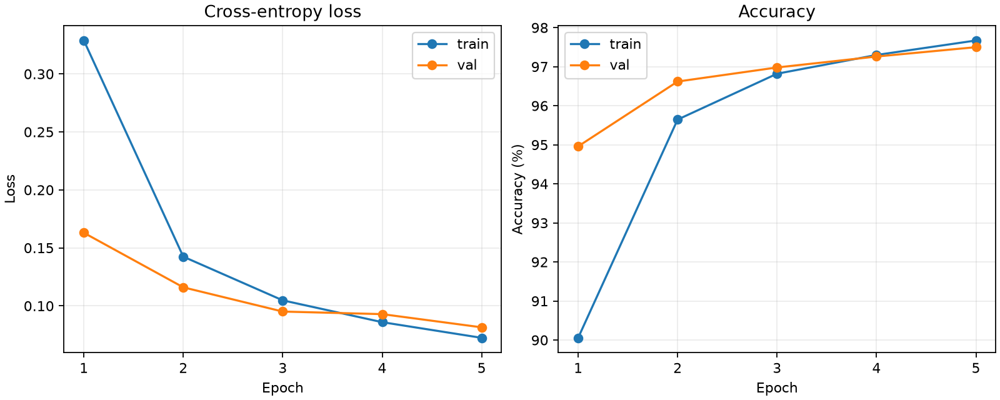
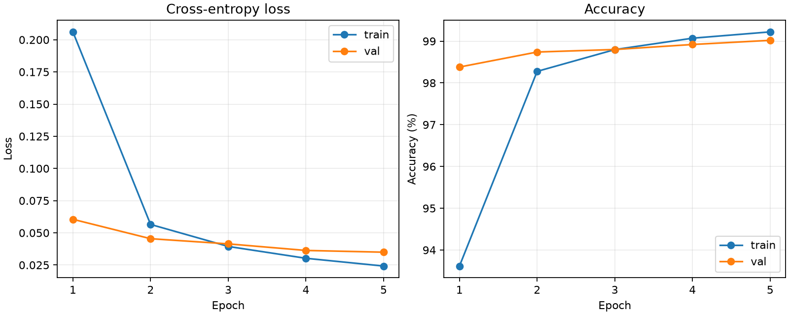
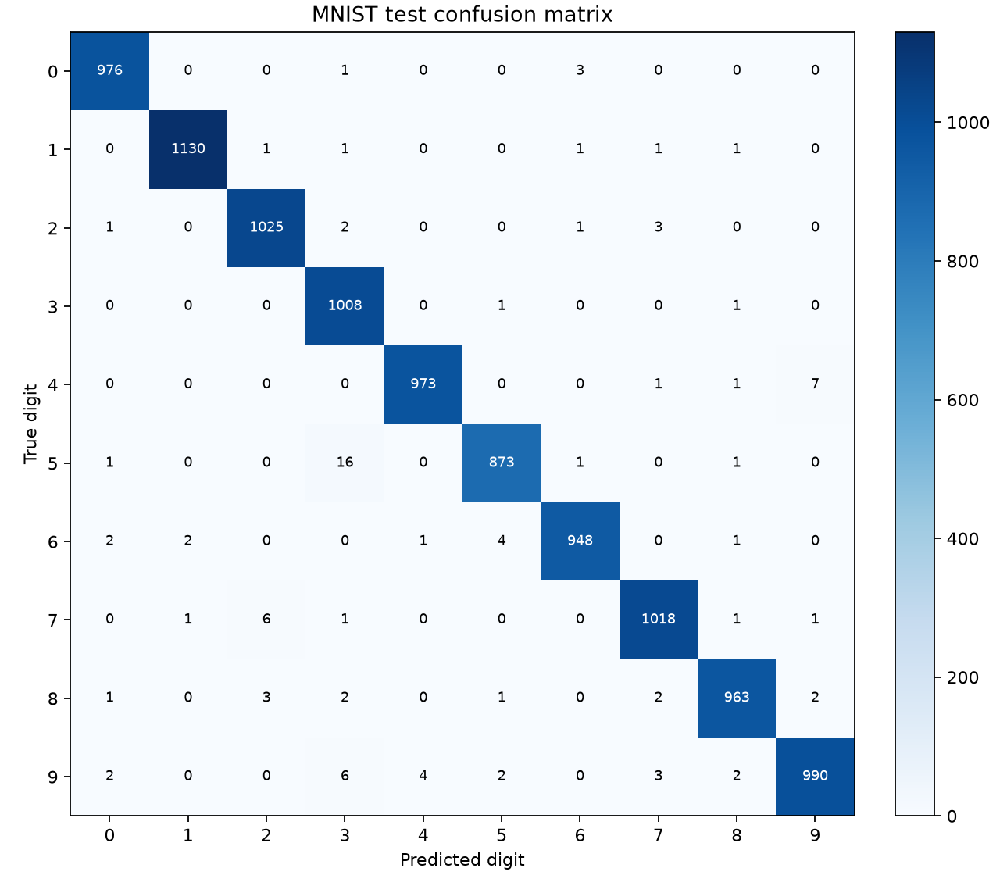
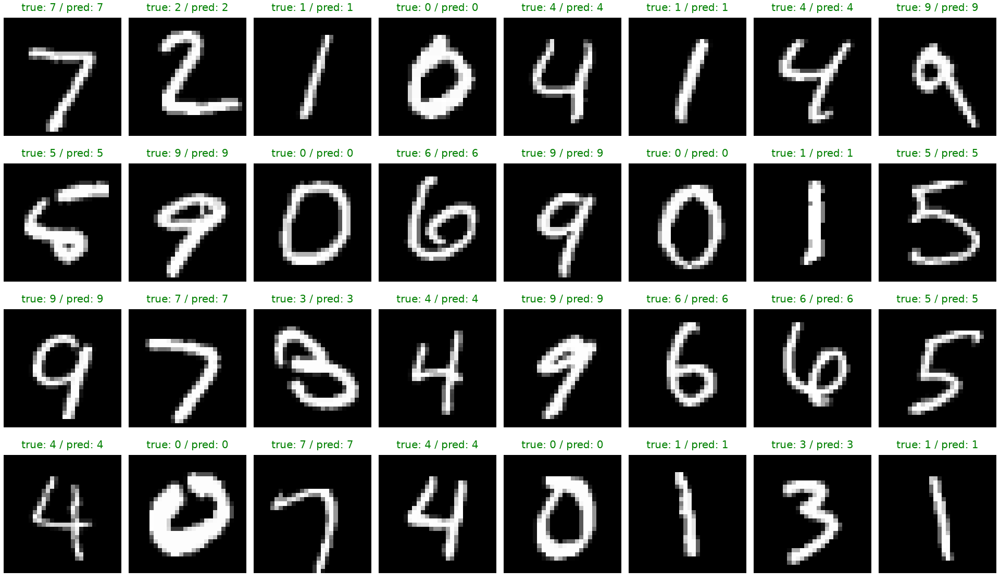

# MNIST Handwritten Digit Classification with PyTorch

A complete training and evaluation workflow for handwritten-digit recognition, comparing a multilayer perceptron (MLP) with a convolutional neural network (CNN). Both models use the same data split, preprocessing, optimiser, seed and evaluation code, so the comparison is like-for-like. The project includes dataset preparation, validation-based checkpoint selection, independent test evaluation and visual diagnostics.

## Model comparison

| Model | Parameters | Best validation accuracy | Independent test accuracy | Test loss |
| --- | --- | --- | --- | --- |
| MLP (`train.py`) | 235,146 | 97.50% | 97.82% (9,782 / 10,000) | 0.0690 |
| CNN (`train_cnn.py`) | 421,642 | 99.02% | **99.04% (9,904 / 10,000)** | 0.0288 |

Both runs: 55,000 / 5,000 / 10,000 train / validation / test images, Adam (lr 0.001), 5 epochs, batch size 128, seed 42, Apple MPS. The CNN makes 122 fewer test errors than the MLP (96 vs 218), largely because convolutions keep the spatial structure that the MLP loses when it flattens each image.

## MLP results

| Setting | Recorded value |
| --- | --- |
| Architecture | 784 → 256 → 128 → 10, ReLU, Dropout (0.2) |
| Training / validation / test images | 55,000 / 5,000 / 10,000 |
| Optimiser | Adam, learning rate 0.001 |
| Epochs / batch size / seed | 5 / 128 / 42 |
| Best validation accuracy | 97.50% |
| Independent test accuracy | **97.82% (9,782 / 10,000)** |
| Test cross-entropy loss | 0.06896 |
| Parameters | 235,146 |

The checkpoint was chosen using validation accuracy. Test data was held out from training and checkpoint selection. The saved model was independently re-evaluated on CPU; see [metrics.json](metrics.json) and [evaluation.json](evaluation.json).

These results describe a single recorded run on MNIST, a controlled benchmark. Hardware and library differences may affect results. The CNN results are reported below.

### MLP visual results




## CNN results

| Setting | Recorded value |
| --- | --- |
| Architecture | Conv(1→32, 3×3) → ReLU → MaxPool → Conv(32→64, 3×3) → ReLU → MaxPool → FC(3136→128) → ReLU → Dropout(0.2) → FC(128→10) |
| Training / validation / test images | 55,000 / 5,000 / 10,000 (same seeded split as the MLP) |
| Optimiser | Adam, learning rate 0.001 |
| Epochs / batch size / seed | 5 / 128 / 42 |
| Best epoch | 5 |
| Best validation accuracy | 99.02% |
| Independent test accuracy | **99.04% (9,904 / 10,000)** |
| Test cross-entropy loss | 0.02876 |
| Parameters | 421,642 |

Most of the CNN's parameters (401,536) sit in the first fully connected layer; the two convolutional layers have only 18,816. Results are in [cnn/metrics.json](cnn/metrics.json) and [cnn/history.csv](cnn/history.csv).







## Run locally

Python 3.14 was used for the recorded run. The direct dependency versions are in `requirements.txt`; `requirements-lock.txt` records the original environment.

```bash
python3 -m venv .venv
source .venv/bin/activate
python -m pip install -r requirements.txt
python train.py
```

The script downloads MNIST via Torchvision and automatically selects CUDA, Apple MPS or CPU. To select CPU explicitly:

```bash
python train.py --device cpu
```

Train the CNN (it reuses the data loading, training and evaluation helpers in `train.py`):

```bash
python train_cnn.py
```

CNN results are written to `outputs_cnn/`; `python train_cnn.py --eval-only` re-evaluates its saved checkpoint.

To download the data without training:

```bash
python train.py --download-only
```

After training, re-evaluate the saved checkpoint without retraining:

```bash
python train.py --eval-only --device cpu
```

Use a separate output directory to preserve an existing run:

```bash
python train.py --epochs 10 --output-dir outputs_10epochs
```

## Repository contents

- `train.py`: data preparation, MLP definition, training, evaluation and visualisation.
- `train_cnn.py`: CNN definition and training, sharing the helpers in `train.py`.
- `cnn/`: recorded CNN run (metrics, history, curves, confusion matrix, predictions).
- `requirements.txt` / `requirements-lock.txt`: dependency versions.
- `metrics.json` / `evaluation.json`: recorded MLP training-run and independent reload results.
- `history.csv`: per-epoch training and validation measurements.
- `training_curves.png`, `confusion_matrix.png`, `confusion_matrix.csv`, `predictions.png`: recorded MLP evaluation artefacts.

Fresh runs write to `outputs/`; downloaded datasets, checkpoints, logs and local environment files are excluded by `.gitignore`. The result files at the repository root (MLP) and in `cnn/` are the recorded run snapshots.

## Methods

Images are normalised using mean 0.1307 and standard deviation 0.3081. The network outputs logits for cross-entropy loss. Dropout is disabled for evaluation. The training-data split and shuffled loader use seeded generators.

## References

- [Torchvision MNIST dataset](https://docs.pytorch.org/vision/stable/generated/torchvision.datasets.MNIST.html)
- [PyTorch](https://pytorch.org/)
