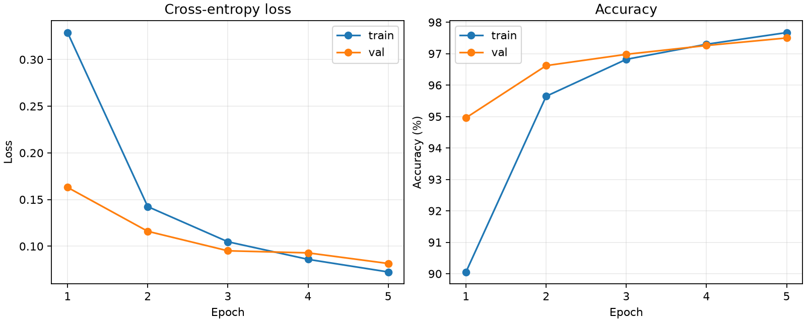
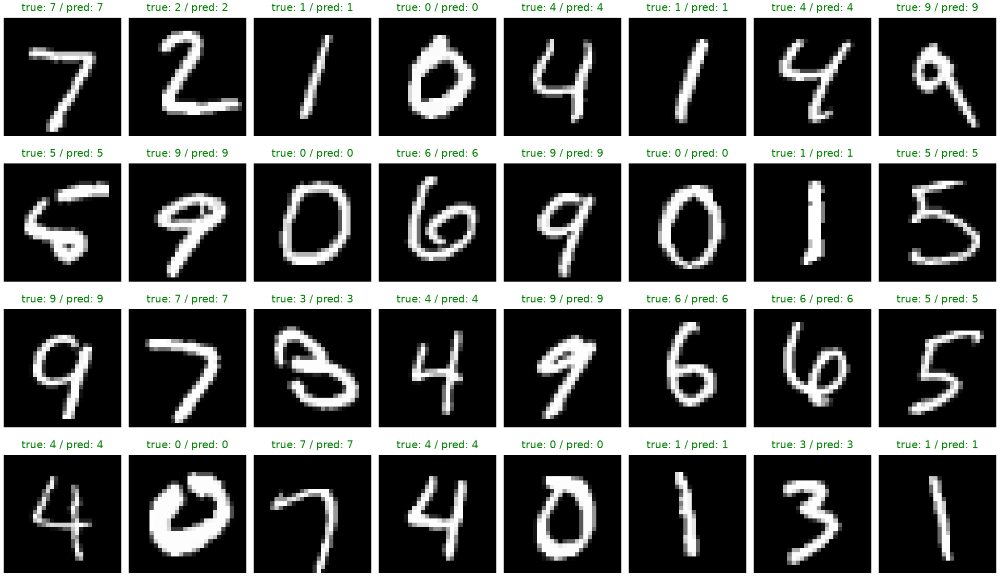
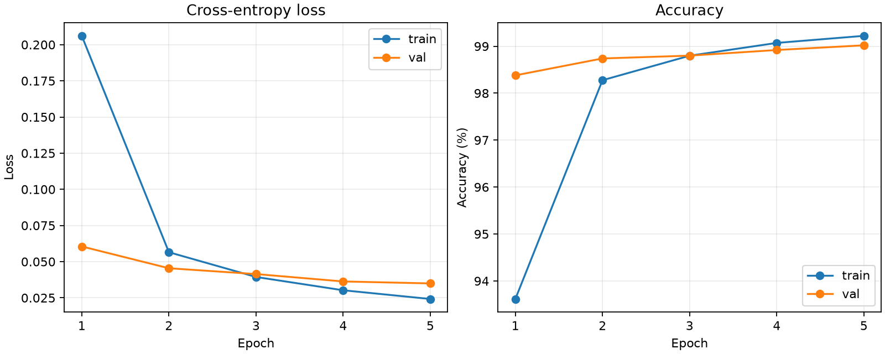
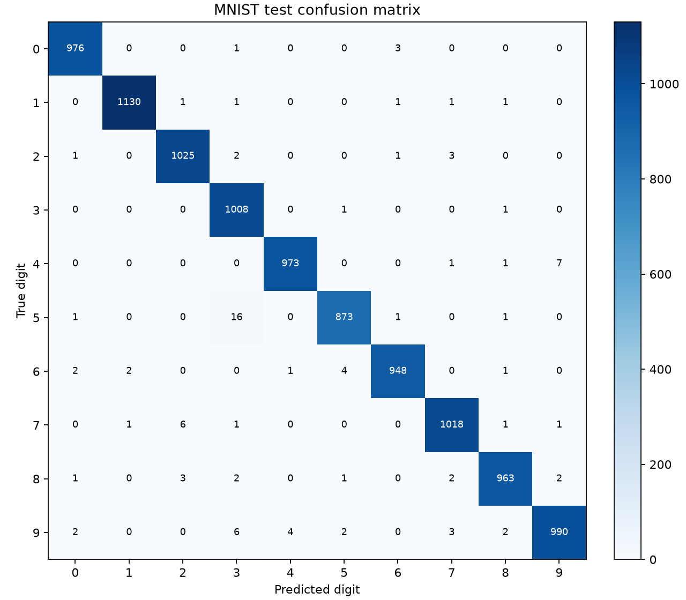

# MNIST Handwritten Digit Classification with PyTorch

Training and evaluation of a multilayer perceptron (MLP) and a convolutional neural network (CNN) on MNIST, using the same data split, preprocessing, optimiser, seed and evaluation code.

## Results

| Model | Parameters | Best validation accuracy | Test accuracy | Test loss |
| --- | --- | --- | --- | --- |
| MLP (`train.py`) | 235,146 | 97.50% | 97.82% (9,782 / 10,000) | 0.0690 |
| CNN (`train_cnn.py`) | 421,642 | 99.02% | **99.04% (9,904 / 10,000)** | 0.0288 |

Both runs: 55,000 / 5,000 / 10,000 train / validation / test images, Adam (lr 0.001), 5 epochs, batch size 128, seed 42.

### MLP

| Setting | Value |
| --- | --- |
| Architecture | 784 → 256 → 128 → 10, ReLU, Dropout (0.2) |
| Best validation accuracy | 97.50% |
| Test accuracy | **97.82% (9,782 / 10,000)** |
| Test cross-entropy loss | 0.06896 |






### CNN

| Setting | Value |
| --- | --- |
| Architecture | Conv(1→32, 3×3) → ReLU → MaxPool → Conv(32→64, 3×3) → ReLU → MaxPool → FC(3136→128) → ReLU → Dropout(0.2) → FC(128→10) |
| Best epoch | 5 |
| Best validation accuracy | 99.02% |
| Test accuracy | **99.04% (9,904 / 10,000)** |
| Test cross-entropy loss | 0.02876 |






## Run

```bash
python3 -m venv .venv
source .venv/bin/activate
python -m pip install -r requirements.txt
```

| Command | What it does |
| --- | --- |
| `python train.py` | Download MNIST, train and evaluate the MLP (selects CUDA, Apple MPS or CPU automatically) |
| `python train.py --device cpu` | Force CPU |
| `python train.py --download-only` | Download the data without training |
| `python train.py --eval-only --device cpu` | Re-evaluate the saved MLP checkpoint |
| `python train.py --epochs 10 --output-dir outputs_10epochs` | Train into a separate output directory |
| `python train_cnn.py` | Train and evaluate the CNN (writes to `outputs_cnn/`) |
| `python train_cnn.py --eval-only` | Re-evaluate the saved CNN checkpoint |

## Code structure

- `train.py` — data preparation (normalisation with mean 0.1307 / std 0.3081, seeded split and loaders), MLP definition, training with validation-based checkpointing, test evaluation and plots
- `train_cnn.py` — CNN definition and training, reusing the helpers in `train.py`
- `requirements.txt` / `requirements-lock.txt` — direct and locked dependency versions
- `metrics.json`, `evaluation.json`, `history.csv`, `confusion_matrix.csv`, `*.png` — recorded MLP run
- `cnn/` — recorded CNN run (metrics, history, curves, confusion matrix, predictions)

Fresh runs write to `outputs/` (MLP) and `outputs_cnn/` (CNN).

## License

[MIT](LICENSE) © 2026 Hanchen Zhang. MNIST is downloaded at runtime via Torchvision and is not included in this repository.
